# Домашнее задание к занятию «Troubleshooting»

Стенд: Oracle VirtualBox VM (Ubuntu 24.04), MicroK8s **v1.35.6** (один узел, IP `10.0.2.15`), `kubectl` **v1.37.1**,
containerd **v2.1.6**, DNS кластера — CoreDNS (аддон `dns`). Задание: установить приложение командой из условия,
выяснить, почему `web-consumer` не может подключиться к `auth-db`, исправить и показать, что проблема решена.

Сырые логи команд — в [`logs/`](logs/), скриншоты — в [`img/`](img/). Из логов вырезано только одно предупреждение
`kubectl` — о разнице версий клиента (1.37) и сервера (1.35); больше в них ничего не правилось.

## Коротко: что оказалось сломано

В манифесте из задания не одна проблема, а три — и главная (из условия) не первая по порядку.

| № | Проблема | Как проявляется | Что сделано |
|---|---|---|---|
| 1 | В `task.yaml` нет объектов `Namespace` для `web` и `data` | `kubectl apply` падает: `namespaces "web" not found` | Созданы namespace'ы ([`00-namespaces.yaml`](manifests/00-namespaces.yaml)) |
| 2 | *(особенность стенда)* образ `radial/busyboxplus:curl` — в формате Docker manifest **schema 1**, containerd v2.1.6 его не принимает | Pod'ы `web-consumer` в `ErrImagePull` | Образ заменён на `curlimages/curl:8.11.1` |
| 3 | **Главная.** `curl auth-db` выполняется в namespace `web`, а Service `auth-db` лежит в `data`; короткое имя DNS ищет только в *своём* namespace | `curl: (6) Could not resolve host: auth-db` | Имя заменено на `auth-db.data.svc.cluster.local` |

Проблема 3 — та, которую просило найти задание. Проблемы 1 и 2 мешают до неё добраться; проблема 2 зависит от
рантайма узла и на другом кластере, скорее всего, не воспроизведётся.

| Файл | Зачем |
|---|---|
| [`manifests/task.yaml`](manifests/task.yaml) | манифест из задания, **без изменений** |
| [`manifests/00-namespaces.yaml`](manifests/00-namespaces.yaml) | недостающие Namespace'ы (для пошагового воспроизведения) |
| [`manifests/fixed.yaml`](manifests/fixed.yaml) | **итоговый** манифест: Namespace'ы + исправленные Deployment'ы и Service, изменения помечены `# FIX N` |
| [`manifests/alt-externalname.yaml`](manifests/alt-externalname.yaml) | альтернативное решение проблемы 3 (Service типа `ExternalName`) |
| [`scripts/reproduce.sh`](scripts/reproduce.sh) | проигрывает всё ДЗ с чистого листа и пишет `logs/*.log` |
| [`scripts/r.sh`](scripts/r.sh), [`image-manifest.sh`](scripts/image-manifest.sh), [`shot.sh`](scripts/shot.sh) | запуск команд с записью `$ команда` в лог; формат манифеста образа в реестре; рендер лога в PNG |

---

## Шаг 1. Установка приложения командой из задания

```bash
kubectl apply -f https://raw.githubusercontent.com/netology-code/kuber-homeworks/main/3.5/files/task.yaml
```

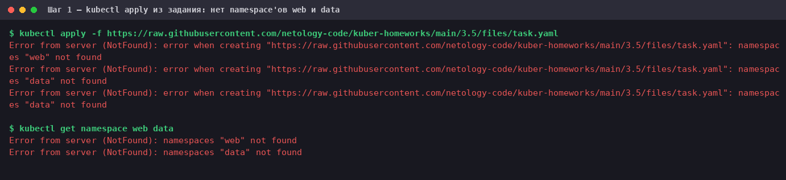

Все три объекта (два Deployment и Service) не создались: `namespaces "web" not found`, `namespaces "data" not found`.
Манифест кладёт объекты в namespace `web` и `data`, но самих `Namespace` в нём нет. `kubectl get namespace web data` подтверждает:
оба не существуют, значит, и создать в них было нечего.

**Проблема 1.** Исправление — создать namespace'ы (в итоговом [`fixed.yaml`](manifests/fixed.yaml) они идут первыми в файле):

```bash
kubectl apply -f manifests/00-namespaces.yaml
kubectl apply -f https://raw.githubusercontent.com/netology-code/kuber-homeworks/main/3.5/files/task.yaml
```

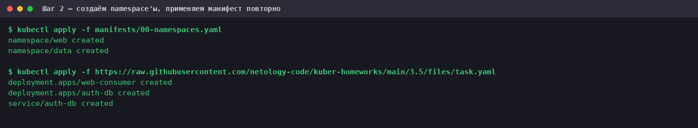

Теперь все три объекта создались.

## Шаг 2. `web-consumer` не стартует: `ErrImagePull`

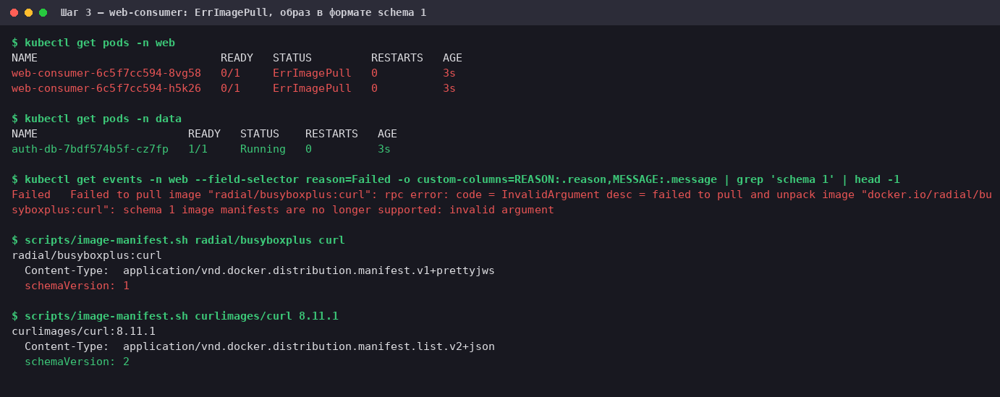

`auth-db` в `data` — `Running`, а Pod'ы `web-consumer` не стартуют: `ErrImagePull` (на момент снимка, 4-я секунда, один из
двух ещё в `ContainerCreating`, затем и он уходит в `ErrImagePull` / `ImagePullBackOff`). Причина — в событиях:

```text
Failed to pull image "radial/busyboxplus:curl": ... schema 1 image manifests are no longer supported
```

Это не сетевая проблема, и к «не может подключиться» она не относится. Чтобы не полагаться только на сообщение containerd,
формат образа проверен независимо — запросом манифеста у Docker Hub ([`scripts/image-manifest.sh`](scripts/image-manifest.sh)):
у `radial/busyboxplus:curl` `schemaVersion: 1` (`…manifest.v1+prettyjws`), у `curlimages/curl:8.11.1` — `schemaVersion: 2`
(`…manifest.list.v2+json`).

**Проблема 2.** Образ в старом формате, который containerd v2.1.6 на этой VM принимать отказывается. Заменяю образ на
`curlimages/curl:8.11.1` — тот же `curl`, но в современном формате; в манифесте задан `command`, поэтому `ENTRYPOINT`
образа (`curl`) не мешает:

```bash
kubectl set image deployment/web-consumer -n web busybox=curlimages/curl:8.11.1
```

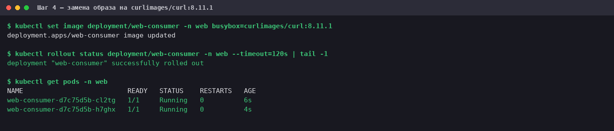

Оба Pod'а `web-consumer` — `Running`. Только теперь виден тот симптом, ради которого задание.

## Шаг 3. Симптом из задания

```bash
kubectl logs -n web deploy/web-consumer --tail=4
```

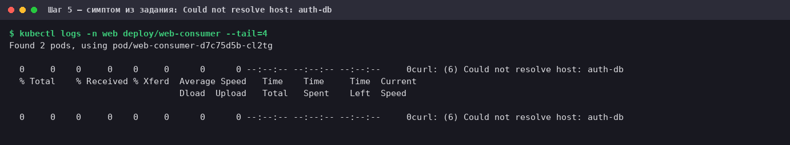

`curl: (6) Could not resolve host: auth-db`. Код 6 у curl — «не удалось разрешить имя», то есть до TCP-соединения дело даже
не дошло: это ошибка DNS, а не «connection refused» и не «timeout».

## Шаг 4. Диагностика

Гипотезы, которые нужно разделить: (а) `auth-db` сам не работает; (б) Service/Endpoints пустые; (в) сеть/NetworkPolicy;
(г) сломан DNS кластера; (д) имя не то, которое ищет приложение.

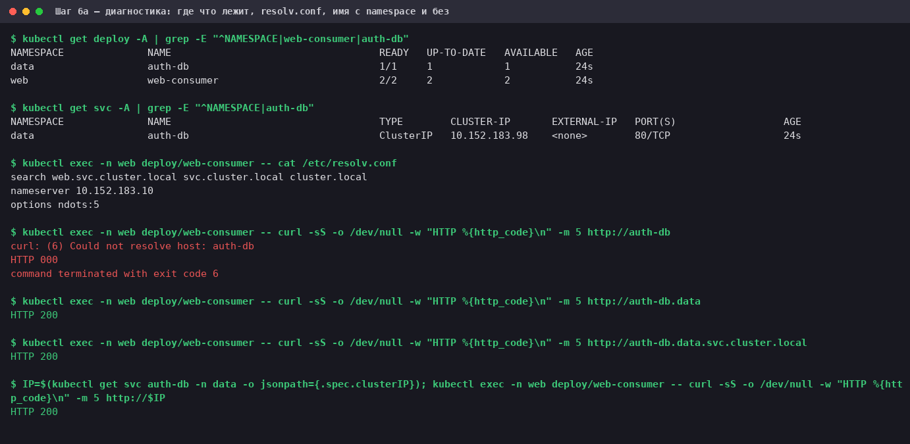

- **Где что лежит:** `web-consumer` — в namespace `web`, `Service auth-db` — в `data`.
- **`/etc/resolv.conf` Pod'а:** `search web.svc.cluster.local svc.cluster.local cluster.local`, `ndots:5`. Короткое имя
  `auth-db` дополняется по очереди этими суффиксами: `auth-db.web.svc.cluster.local`, `auth-db.svc.cluster.local`,
  `auth-db.cluster.local`. Первый суффикс — это namespace **самого Pod'а** (`web`); в нём Service `auth-db` нет, а настоящий
  лежит в `data`. Ни один из вариантов не существует → `NXDOMAIN`.
- **Решающий эксперимент** (всё из того же Pod'а):

  | Обращение | Результат |
  |---|---|
  | `http://auth-db` | **`Could not resolve host`**, HTTP 000 |
  | `http://auth-db.data` | HTTP 200 |
  | `http://auth-db.data.svc.cluster.local` | HTTP 200 |
  | `http://<ClusterIP Service>` | HTTP 200 |

  Если указать namespace (или IP), всё работает. Значит, `auth-db` жив, Service отдаёт на него трафик, сеть между
  namespace'ами проходит — не работает именно короткое имя.

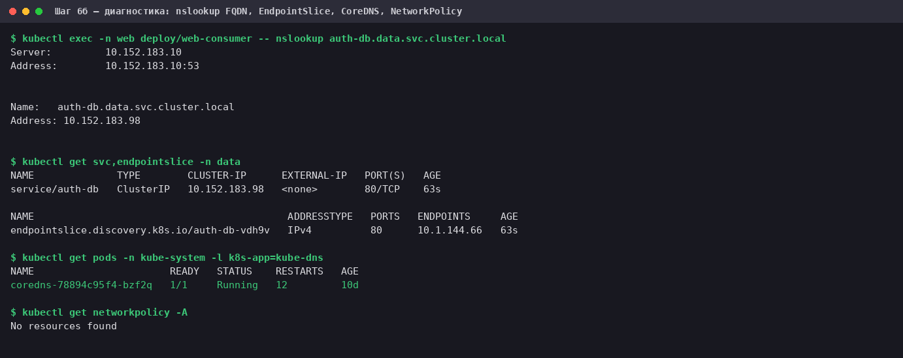

- `nslookup auth-db.data.svc.cluster.local` возвращает ClusterIP того самого Service из `data`.
- У Service есть `EndpointSlice` с адресом Pod'а `auth-db` (проблемы (б) нет), CoreDNS `Running` (проблемы (г) нет),
  `kubectl get networkpolicy -A` → `No resources found` (проблемы (в) нет).

**Проблема 3, итог диагностики:** DNS-имя Service в Kubernetes — `<service>.<namespace>.svc.cluster.local`; короткое
`<service>` работает только внутри *того же* namespace. `web-consumer` и `auth-db` в разных namespace'ах, а команда
`curl auth-db` использует короткое имя.

## Шаг 5. Исправление

Меняется команда `web-consumer`: короткое имя → полное имя Service с namespace. Образ — из шага 2. Итоговый манифест —
[`manifests/fixed.yaml`](manifests/fixed.yaml); различия с исходным:

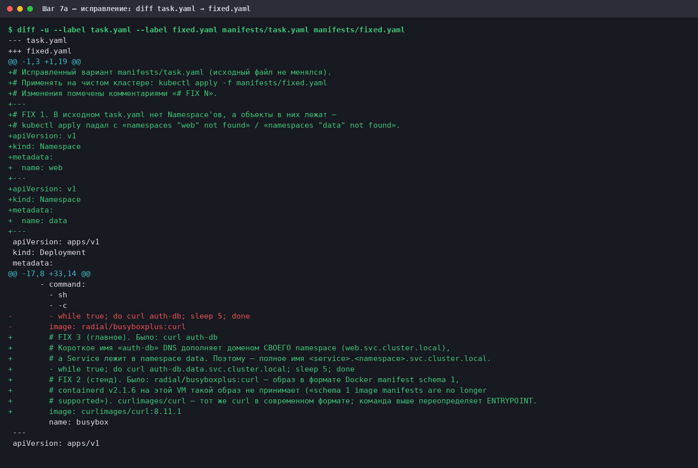

Ключевое место (`Deployment web-consumer`):

```yaml
      containers:
      - command:
        - sh
        - -c
        - while true; do curl auth-db.data.svc.cluster.local; sleep 5; done   # было: curl auth-db
        image: curlimages/curl:8.11.1                                          # было: radial/busyboxplus:curl
        name: busybox
```

Выбрано **полное** имя `auth-db.data.svc.cluster.local`, а не `auth-db.data`: оно однозначно и не зависит от
search-доменов Pod'а (оба варианта для curl работают — см. шаг 4, но для других инструментов это не так, см. «Оговорки»).

```bash
kubectl apply -f manifests/fixed.yaml
```

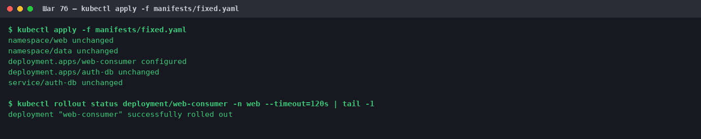

`web-consumer` — `configured`, остальное `unchanged`; rollout завершился.

## Шаг 6. Проверка, что проблема решена

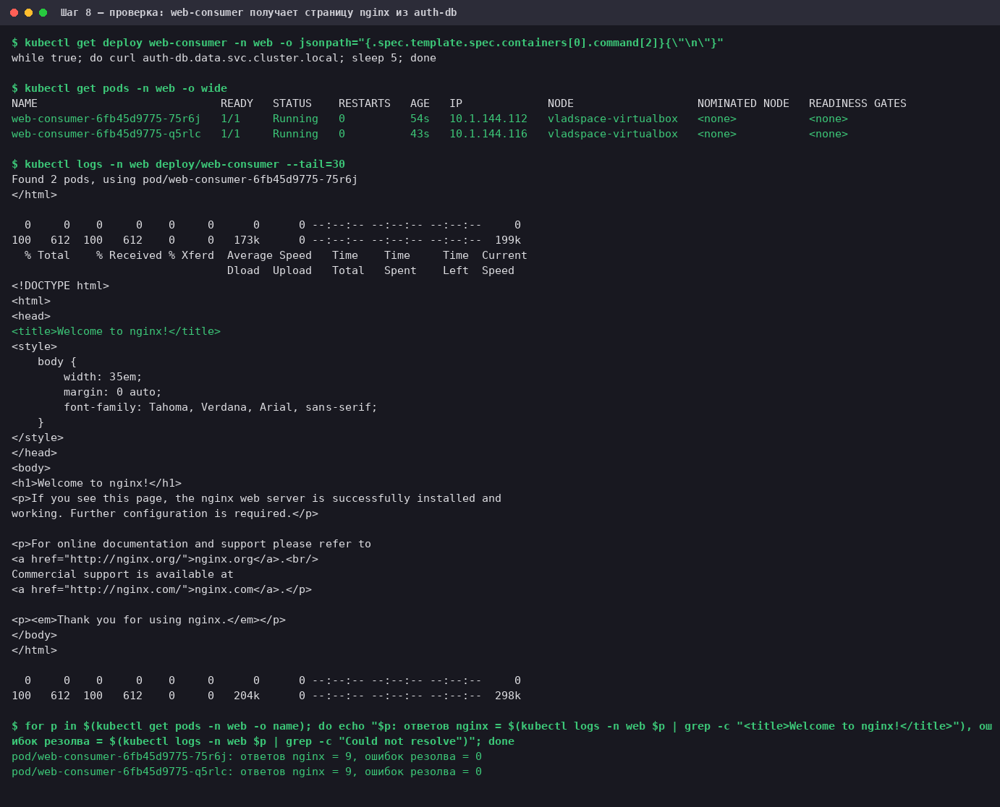

- В живом Deployment — новая команда с `auth-db.data.svc.cluster.local`.
- Оба Pod'а `Running`, `RESTARTS 0`.
- В логах `web-consumer` — настоящая страница `Welcome to nginx!` от `auth-db` вместо `Could not resolve host`.
- Счётчик по логам обоих Pod'ов: по **9 ответов `<title>Welcome to nginx!</title>`** (≈ возраст Pod'а / 5 с) и **0 ошибок
  резолва**. (Считаю по `<title>`, потому что фраза «Welcome to nginx» на странице встречается дважды.)

## Альтернатива: `ExternalName`, без правки приложения

Если приложение трогать нельзя, в namespace `web` можно создать Service-алиас [`auth-db`](manifests/alt-externalname.yaml)
типа `ExternalName`, указывающий на `auth-db.data.svc.cluster.local`. Тогда короткое имя `auth-db` снова находится в
«своём» namespace:

```bash
kubectl apply -f manifests/alt-externalname.yaml
```

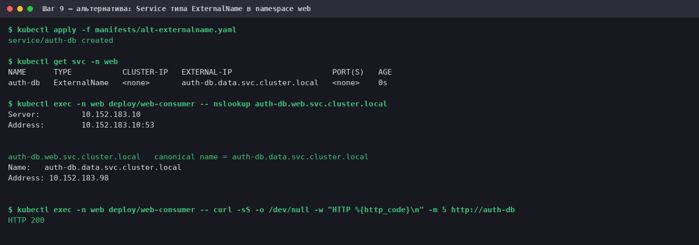

`nslookup auth-db.web.svc.cluster.local` отдаёт `canonical name = auth-db.data.svc.cluster.local`, а `curl http://auth-db`
(короткое имя, как в исходной команде) — HTTP 200. Это решение я проверил только для HTTP-запроса по имени; поведение с TLS
(где проверяется совпадение имени в сертификате) не проверял. После проверки алиас удалён — основное решение от него не зависит.

---

## Оговорки

- **`nslookup` из busybox вводит в заблуждение.** В Pod'е `nslookup auth-db.data` возвращает `NXDOMAIN`, хотя `curl` по тому же
  имени получает 200 ([`logs/10_nslookup_quirk.log`](logs/10_nslookup_quirk.log)). Я не раскапывал глубже — по поведению это
  похоже на то, что busybox-`nslookup` не расширяет такое имя search-доменами так, как резолвер, который использует `curl`.
  Поэтому в диагностике решающие проверки сделаны `curl`'ом (то, что делает само приложение) и `nslookup` по полному имени.

  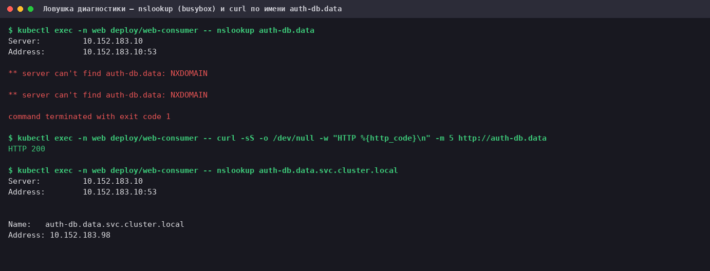

- **Проблема 2 зависит от стенда.** Что `schema 1` на этой VM не принимается — проверено (сообщение containerd v2.1.6 +
  независимый запрос манифеста). Как поведёт себя этот образ на кластере с другим рантаймом — не проверял.
- **Паузы узла в пробном прогоне.** В одном из черновых прогонов (его логи не сохранены) ответы в обоих Pod'ах
  `web-consumer` одновременно пропали почти на минуту; метки времени двух разных контейнеров совпали до миллисекунды.
  Поиск по журналу systemd за это окно по ключевым словам (`hung`, `timeout`, `stall`, `slow`, `PLEG` и т. п.) ничего не дал.
  Причину не установил (ошибок резолва в это время не было); в итоговом
  прогоне, по которому сделаны логи и скриншоты, этого не наблюдалось. Если число ответов в `08_verify.log` у вас окажется меньше
  «возраст Pod'а / 5 с», это не обязательно сбой приложения.
- **Не проверялось:** запасные варианты (перенос приложения в один namespace, передача адреса через переменную окружения),
  изменение NetworkPolicy — в кластере их нет.

## Что изменено в кластере и как убрать

Всё ДЗ — в двух namespace'ах: **`web`** (Deployment `web-consumer`) и **`data`** (Deployment и Service `auth-db`).
Больше ничего в кластере не менялось (аддоны не включались). Убрать:

```bash
kubectl delete namespace web data
```

На узле в кэше containerd останутся образы `curlimages/curl:8.11.1` и `nginx:1.19.1`.

## Как воспроизвести

```bash
scripts/reproduce.sh     # удалит namespace'ы web и data, проиграет все шаги и пересоздаст logs/*.log
scripts/shot.sh logs/05_symptom.log img/05_symptom.png "Заголовок"     # лог → PNG (нужен ~/bin/render-term.py)
```
